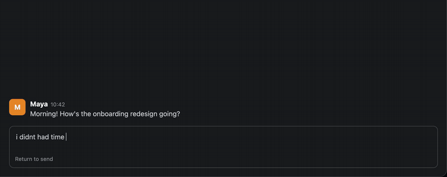
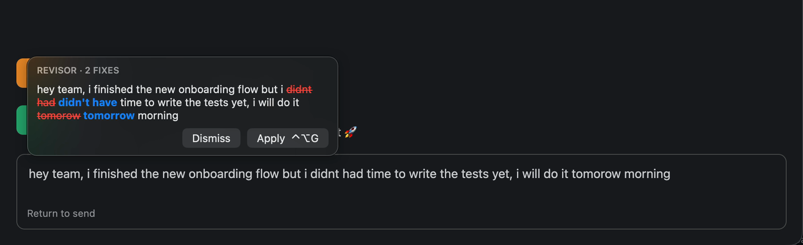
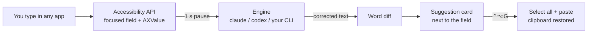

<div align="center">

# ✎ Revisor

**AI proofreading in every text field on your Mac, powered by the AI subscription you already pay for.**

A tiny native menu bar app (~400 KB, Swift) that watches what you type in Slack, Gmail, GitHub, Notes or any other app,
and suggests fixes the moment you stop typing. It uses **Claude Code** or **Codex** on your machine,
so there are no API keys, no extra subscription, and no new account to trust with your writing.

[](https://github.com/AllanLotta/revisor/actions/workflows/ci.yml)


[](LICENSE)



</div>

---

## Why

Grammar checkers that work everywhere are great, but they're another subscription and another company reading
everything you type. If you're a developer, you probably already pay for Claude (Claude Code) or ChatGPT (Codex),
and those CLIs are sitting on your machine, logged in.

Revisor turns them into a system-wide proofreader:

- **Works in any app.** Native fields, Chrome/Safari pages, Electron apps like Slack and Discord.
- **Uses your existing plan.** It drives the `claude` or `codex` CLI you're already logged into.
  It strips API keys from the environment on purpose, so it never falls back to metered API billing.
- **Fast.** With Claude Code it keeps one warm process, and Haiku answers in **~0.7 s**.
- **Respects your voice.** Minimal edits: spelling, grammar, punctuation, clearly unnatural phrasing.
  No rewriting, no "make it formal", no translating. Casual stays casual, any language stays in that language.
- **Out of your way.** Nothing happens until you pause. One shortcut applies the fix, and your app's own ⌘Z undoes it.
- **Small and auditable.** About 1,400 lines of Swift, no dependencies, no telemetry.

## Features

| | |
|---|---|
| ✍️ **Real-time review** | Reviews the focused text field 1 s after you stop typing |
| 🔍 **Clear diff card** | Red strikethrough is removed, blue is added, shown right next to the field |
| ⚡ **One-key apply** | <kbd>⌃</kbd><kbd>⌥</kbd><kbd>G</kbd> applies, <kbd>⌃</kbd><kbd>⌥</kbd><kbd>R</kbd> reviews right now |
| 🧠 **Pick your engine** | Claude Code (default), Codex, or any CLI you like (Ollama, your own script…) |
| 🌍 **Any writing language** | Fixes the text in the language it's written in |
| 🗣️ **Localized UI** | English and Portuguese, follows your system language |
| 🔒 **Privacy-minded** | Skips password fields, terminals, IDEs and password managers; logs never contain your text |
| 🚀 **Launch at login** | One click in the menu |

<p align="center">
  
</p>

## Install

Requirements: macOS 13 or later, Xcode command line tools (`xcode-select --install`), and at least one engine:

- **[Claude Code](https://docs.claude.com/en/docs/claude-code)** logged in with your Claude plan (run `claude` once), or
- **[Codex CLI](https://github.com/openai/codex)** logged in with your ChatGPT plan (`codex login`).

```bash
git clone https://github.com/AllanLotta/revisor.git
cd revisor
./build.sh --install
```

That builds `Revisor.app`, copies it to `~/Applications` and opens it. A ✎ appears in the menu bar.

**Grant Accessibility access** when macOS asks (System Settings › Privacy & Security › Accessibility › Revisor).
Revisor needs it to read the focused text field and paste the fix, the same permission every grammar checker,
clipboard manager and window manager uses.

> **Tip:** if you have an Apple Development certificate, `build.sh` signs with it automatically, so the permission
> survives rebuilds. Without one the app is signed ad hoc and macOS may ask again after each rebuild.

## Usage

Just type. When you pause, Revisor reviews the text and, if something's off, shows a card next to the field.

| Shortcut | Action |
|---|---|
| <kbd>⌃</kbd><kbd>⌥</kbd><kbd>G</kbd> | Apply the suggestion (or click **Apply**) |
| <kbd>⌃</kbd><kbd>⌥</kbd><kbd>R</kbd> | Review the current field now |
| <kbd>⌘</kbd><kbd>Z</kbd> | Undo, handled by the app you're typing in |

The menu bar icon tells you what's going on:

| Icon | Meaning |
|---|---|
| `✎` | Ready |
| `✎…` | Reviewing |
| `✎✓` | No issues found (or fix applied) |
| `✎2` | 2 fixes waiting |
| `✎⏸` | Paused |
| `✎⚠` | Needs permission, or the engine failed (see **Open Log**) |

From the menu you can pause, switch engines, toggle launch at login, and open the config file or the log.

## Engines

| Engine | How it runs | Typical latency* | Uses |
|---|---|---|---|
| **Claude Code** (default) | One warm `claude -p --input-format stream-json` process, recycled every 20 reviews | **0.6–0.9 s** with `claude-haiku-5-5` | Your Claude plan |
| **Codex** | `codex exec` per review, read-only sandbox, ephemeral session | ~5–6 s | Your ChatGPT plan |
| **Custom command** | Any CLI that reads the prompt on stdin and prints the answer | depends | Whatever you point it at |

<sub>* Measured on an Apple Silicon MacBook, short chat messages.</sub>

The model only has to return the corrected text inside `<fixed>…</fixed>`, so almost any instruction-following model works.
Examples of custom commands:

```jsonc
{ "provider": "command", "command": ["ollama", "run", "llama3.2"] }      // fully local
{ "provider": "command", "command": ["/Users/me/bin/my-proofreader.sh"] } // your own script
```

## Configuration

Settings live in `~/Library/Application Support/Revisor/config.json` (menu › **Open Config File…**, then **Reload Config**).
Every key is optional. A full example is in [`examples/config.example.json`](examples/config.example.json):

```json
{
  "provider": "claude",
  "model": "claude-haiku-5-5",
  "about": "Software engineer. Writes in English and Spanish, casual tone in chat."
}
```

| Key | Default | What it does |
|---|---|---|
| `provider` | `"claude"` | `claude`, `codex` or `command` |
| `model` | `""` | Model for the CLI. Empty uses `haiku` for Claude Code and your default for Codex |
| `effort` | `"low"` | Reasoning effort passed to the CLI |
| `command` | `[]` | Executable and arguments for `provider: "command"` |
| `about` | `""` | A sentence about you, so the model knows your languages and tone |
| `debounceSeconds` | `1.0` | Pause before a review starts |
| `minCharacters` / `maxCharacters` | `8` / `2500` | Texts outside this range are skipped |
| `language` | `""` | UI language: `en`, `pt`, or empty to follow the system |
| `ignoredApps` | terminals, IDEs, password managers | Bundle IDs where Revisor stays quiet |

## How it works



1. **Read.** Every 0.35 s Revisor asks the frontmost app for its focused element through the macOS Accessibility API
   and reads its value. Chromium and Electron apps only expose web content to assistive apps, so Revisor turns on
   `AXEnhancedUserInterface` / `AXManualAccessibility` for them, like screen readers do.
2. **Review.** Once the text stops changing, it goes to the engine with a strict proofreading prompt. The text is
   treated as data, so instructions inside it are ignored.
3. **Show.** A word-level diff is drawn in a non-activating panel next to the field (or near the caret in large
   fields), so clicking it never steals focus from the app you're writing in.
4. **Apply.** Revisor selects the field's text through Accessibility and pastes the fix. Setting the value directly
   is ignored by most web editors; pasting works in native, web and Electron fields and keeps the app's undo.
   Your clipboard is restored right after.

## Privacy

- Your text goes **only** to the engine you chose, through its own CLI and your own account. Revisor has no server.
- API keys (`ANTHROPIC_*`, `OPENAI_API_KEY`, …) are never passed to the CLI, and Claude Code is refused if it
  reports an API key, so reviews always run on your logged-in plan.
- Password fields are never read. Terminals, IDEs and password managers are ignored by default (editable list).
- The log (`~/Library/Logs/Revisor.log`) only has timings and counts, never text.
- Claude Code runs with no tools, no MCP servers, no project memory and no session persistence.
  Codex runs in a read-only sandbox with an ephemeral session.

## Tested in

| App | Field | Result |
|---|---|---|
| Slack (desktop) | Message composer | ✅ review + apply |
| Chrome | `<textarea>` | ✅ review + apply |
| Chrome | Rich editor (`contenteditable`, Gmail-style) | ✅ review |
| TextEdit | Document | ✅ review + apply |

Found an app where it doesn't work? Please [open an issue](https://github.com/AllanLotta/revisor/issues) with the app name and version.

## Roadmap

- [ ] Underline issues inline, in the text itself
- [ ] Accept fixes one by one instead of the whole text
- [ ] Review only the paragraph around the caret in long documents (emails with quoted history)
- [ ] "Rewrite in natural English" mode for non-native writers
- [ ] Prebuilt, notarized release
- [ ] Per-app settings

## Development

```bash
swift build              # debug build
swift test               # unit tests (diff, prompt parsing, config, strings)
./build.sh               # release .app in the repo folder
```

```
Sources/
  RevisorCore/           # pure logic, no AppKit, unit-tested
    Diff.swift           # word-level diff
    Prompt.swift         # proofreading prompt + answer parsing
    Config.swift         # config.json model and store
    L10n.swift           # UI strings (en, pt)
  Revisor/               # the menu bar app
    AppController.swift  # main loop, state, menu
    Accessibility/       # reading fields, replacing text
    AI/                  # Claude Code, Codex and custom-command engines
    UI/                  # suggestion card
    Support/             # log, hotkeys, launch at login
docs/demo/               # demo pages used for the recordings
```

**Adding a UI language:** add a case to `L10n.Language` and fill in the strings in `Sources/RevisorCore/L10n.swift`.
**Adding an engine:** implement `ProofreadEngine` (`Sources/Revisor/AI/Engine.swift`) and register it in `EngineFactory`.

PRs welcome. Please run `swift test` before opening one.

## FAQ

**Does it work without Claude Code or Codex?** Yes, with `provider: "command"` and any CLI, including fully local
models through Ollama.

**Will it fight my app's autocorrect?** No. It only suggests; nothing changes until you apply.

**Can it send a message by accident?** No. It never presses Return; it only selects and pastes into the field.

**Why not the App Store?** Sandboxed apps can't use the Accessibility API this way.

---

<sub>Revisor is an independent open-source project and is not affiliated with Anthropic, OpenAI or Grammarly.
Claude, Codex and Grammarly are trademarks of their respective owners. MIT licensed.</sub>
