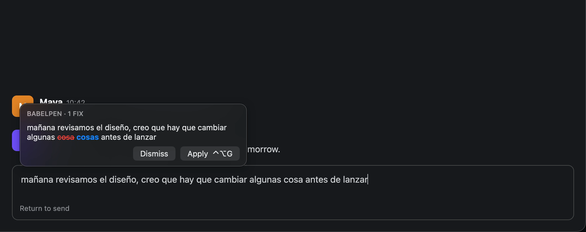
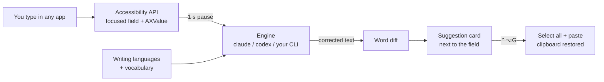

<div align="center">

# 🖊 Babelpen

### Don't panic. Your typos are handled, in any language, in any app.

**AI proofreading for every macOS text field, powered by the Claude or ChatGPT plan you already pay for.**

A tiny native menu bar app (~400 KB, Swift) that fixes what you write in Slack, Gmail, GitHub, Notes or anywhere else,
the moment you stop typing, in whatever language you're writing. It runs on **Claude Code** or **Codex** on your own
machine: no API keys, no extra subscription, no new company reading everything you type.

[](https://github.com/AllanLotta/babelpen/actions/workflows/ci.yml)
[](https://github.com/AllanLotta/babelpen/releases/latest)


[](LICENSE)


<sub>English, Spanish, French: each message is fixed in its own language, never translated.</sub>

</div>

---

## Install

```bash
curl -fsSL https://raw.githubusercontent.com/AllanLotta/babelpen/main/install.sh | bash
```

Or grab the `.dmg` from the [latest release](https://github.com/AllanLotta/babelpen/releases/latest) and drag Babelpen
to Applications. Universal build, runs on Apple Silicon and Intel, macOS 13 or later.

Then:

1. **Allow Accessibility access** when macOS asks (System Settings › Privacy & Security › Accessibility › Babelpen).
   It's how Babelpen reads the field you're typing in and pastes the fix, the same permission every grammar checker,
   clipboard manager and window manager uses.
2. **Have one AI CLI logged in**:
   [Claude Code](https://docs.claude.com/en/docs/claude-code) with your Claude plan (run `claude` once), or
   [Codex](https://github.com/openai/codex) with your ChatGPT plan (`codex login`).

A ✎ appears in your menu bar. Start typing anywhere.

> Releases are signed with a Developer ID and **notarized by Apple**, so they open with a double click and keep the
> Accessibility permission across updates. Prefer to build it yourself? See [Build from source](#build-from-source).

## Why

Grammar checkers that work everywhere are great, but they're another subscription and another company reading
everything you type. If you're a developer, you probably already pay for Claude or ChatGPT, and their CLIs are sitting
on your machine, logged in. Babelpen turns them into a system-wide proofreader:

- 🌍 **Every language, never translated.** Writing Italian as a New Yorker, English as a Brazilian, German as a
  Spaniard? Babelpen fixes each text in the language it's written in, and keeps mixed-language text mixed.
- 💸 **Uses the plan you already have.** It drives the `claude` or `codex` CLI you're logged into and strips API keys
  on purpose, so it never falls back to metered API billing.
- ⚡ **Fast.** With Claude Code it keeps one warm process; Haiku answers in **~0.7 s**.
- 🗣️ **Keeps your voice.** Minimal edits: spelling, grammar, accents, punctuation, clearly unnatural phrasing.
  No rewriting, no "make it formal". Casual stays casual.
- 📖 **Knows your words.** Names, products, jargon and slang go in your vocabulary and are never "corrected".
- 🪶 **Out of your way.** Nothing happens until you pause. One shortcut applies the fix, and your app's own ⌘Z undoes it.
- 🔍 **Small and auditable.** About 1,700 lines of Swift, zero dependencies, no telemetry, no server.

## Features

| | |
|---|---|
| ✍️ **Real-time review** | Reviews the focused text field 1 s after you stop typing |
| 🔍 **Clear diff card** | Red strikethrough is removed, blue is added, right next to the field |
| ⚡ **One-key apply** | <kbd>⌃</kbd><kbd>⌥</kbd><kbd>G</kbd> applies, <kbd>⌃</kbd><kbd>⌥</kbd><kbd>R</kbd> reviews right now |
| 🌍 **Writing languages** | Pick the languages you write in (defaults to your system's); any language works |
| 📖 **Your vocabulary** | Select a word, press <kbd>⌃</kbd><kbd>⌥</kbd><kbd>V</kbd>: Babelpen will never touch it again |
| 🗣️ **Interface in 6 languages** | English, Português, Español, Français, Deutsch, Italiano |
| 🧠 **Pick your engine** | Claude Code (default), Codex, or any CLI (Ollama, your own script…) |
| 🔒 **Privacy-minded** | Skips password fields, terminals, IDEs and password managers; logs never contain your text |
| 🚀 **Launch at login** | One click in the menu |

<p align="center">
  
</p>

## Usage

Just type. When you pause, Babelpen reviews the text and, if something's off, shows a card next to the field.

| Shortcut | Action |
|---|---|
| <kbd>⌃</kbd><kbd>⌥</kbd><kbd>G</kbd> | Apply the suggestion (or click **Apply**) |
| <kbd>⌃</kbd><kbd>⌥</kbd><kbd>R</kbd> | Review the current field now |
| <kbd>⌃</kbd><kbd>⌥</kbd><kbd>V</kbd> | Add the selected word to your vocabulary |
| <kbd>⌘</kbd><kbd>Z</kbd> | Undo, handled by the app you're typing in |

The menu bar icon tells you what's going on:

| Icon | Meaning |
|---|---|
| `✎` | Ready |
| `✎…` | Reviewing |
| `✎✓` | No issues found (or fix applied) |
| `✎2` | 2 fixes waiting |
| `✎⏸` | Paused |
| `✎⚠` | Needs permission, or the engine failed (see **Open Log**) |

From the menu: pause, switch engine, writing languages, interface language, vocabulary, launch at login, config and log.

### Languages

There are two separate settings, both in the menu:

- **Writing Languages:** the languages you write in. By default they match your Mac's preferred languages. Add
  the one you're learning (say, Italian) and remove the ones you don't use. It's a hint for accents, spelling
  conventions and ambiguous words; text in any language still gets fixed in that language.
- **Interface Language:** the language of Babelpen's own menus and buttons. Follows your system by default.

### Vocabulary

Your own words, kept exactly as written: never corrected, translated or re-capitalized. Great for names
("Siobhán", "Nguyen"), products and internal jargon ("k8s", "Expo Router"), and slang you mean to use ("gonna").

- Select a word anywhere and press <kbd>⌃</kbd><kbd>⌥</kbd><kbd>V</kbd>, or
- Menu › **Edit Vocabulary…** opens `vocabulary.txt`: one word or phrase per line. Changes apply on the next review.

## Engines

| Engine | How it runs | Typical latency* | Uses |
|---|---|---|---|
| **Claude Code** (default) | One warm `claude -p --input-format stream-json` process, recycled every 20 reviews | **0.6–0.9 s** with `claude-haiku-5-5` | Your Claude plan |
| **Codex** | `codex exec` per review, read-only sandbox, ephemeral session | ~5–6 s | Your ChatGPT plan |
| **Custom command** | Any CLI that reads the prompt on stdin and prints the answer | depends | Whatever you point it at |

<sub>* Measured on an Apple Silicon MacBook with short chat messages.</sub>

The model only has to return the corrected text inside `<fixed>…</fixed>`, so any instruction-following model works:

```jsonc
{ "provider": "command", "command": ["ollama", "run", "llama3.2"] }       // fully local
{ "provider": "command", "command": ["/Users/me/bin/my-proofreader.sh"] }  // your own script
```

## Configuration

Settings live in `~/Library/Application Support/Babelpen/config.json` (menu › **Open Config File…**, then
**Reload Config**). Every key is optional; see [`examples/config.example.json`](examples/config.example.json).

```json
{
  "provider": "claude",
  "model": "claude-haiku-5-5",
  "languages": ["en", "it"],
  "about": "Product designer from Chicago, learning Italian. Casual tone in chat."
}
```

| Key | Default | What it does |
|---|---|---|
| `provider` | `"claude"` | `claude`, `codex` or `command` |
| `model` | `""` | Model for the CLI. Empty uses `haiku` for Claude Code and your default for Codex |
| `effort` | `"low"` | Reasoning effort passed to the CLI |
| `command` | `[]` | Executable and arguments for `provider: "command"` |
| `languages` | `[]` | Writing languages as ISO codes (`"en"`, `"pt"`, `"ja"`…). Empty = your system's |
| `interfaceLanguage` | `""` | `en`, `pt`, `es`, `fr`, `de`, `it`, or empty to follow the system |
| `about` | `""` | A sentence about you: where you're from, what you write, your tone |
| `debounceSeconds` | `1.0` | Pause before a review starts |
| `minCharacters` / `maxCharacters` | `8` / `2500` | Texts outside this range are skipped |
| `ignoredApps` | terminals, IDEs, password managers | Bundle IDs where Babelpen stays quiet |

Your vocabulary lives next to it, in `vocabulary.txt`.

## How it works



1. **Read.** Every 0.35 s Babelpen asks the frontmost app for its focused element through the macOS Accessibility API
   and reads its value. Chromium and Electron apps only expose web content to assistive apps, so Babelpen turns on
   `AXEnhancedUserInterface` / `AXManualAccessibility` for them, like screen readers do.
2. **Review.** Once the text stops changing, it goes to the engine with a strict proofreading prompt plus your writing
   languages and vocabulary. The text is treated as data, so instructions inside it are ignored.
3. **Show.** A word-level diff is drawn in a non-activating panel next to the field (or near the caret in large
   fields), so clicking it never steals focus from the app you're writing in.
4. **Apply.** Babelpen selects the field's text through Accessibility and pastes the fix, only if that app is still in
   front. Setting the value directly is ignored by most web editors; pasting works in native, web and Electron fields
   and keeps the app's undo. Your clipboard is restored right after.

## Privacy

- Your text goes **only** to the engine you chose, through its own CLI and your own account. Babelpen has no server.
- API keys (`ANTHROPIC_*`, `OPENAI_API_KEY`, …) are never passed to the CLI, and Claude Code is refused if it
  reports an API key, so reviews always run on your logged-in plan.
- Password fields are never read. Terminals, IDEs and password managers are ignored by default (editable list).
- The log (`~/Library/Logs/Babelpen.log`) only has timings and counts, never text.
- Claude Code runs with no tools, no MCP servers, no project memory and no session persistence.
  Codex runs in a read-only sandbox with an ephemeral session.

## Tested in

| App | Field | Result |
|---|---|---|
| Slack (desktop) | Message composer | ✅ review + apply |
| Chrome | `<textarea>` | ✅ review + apply |
| Chrome | Rich editor (`contenteditable`, Gmail-style) | ✅ review |
| TextEdit | Document | ✅ review + apply |

Languages tried so far: English, Portuguese, Spanish, French, Italian.
Found an app or a language where it doesn't work well?
Please [open an issue](https://github.com/AllanLotta/babelpen/issues) with the app, its version and the language.

## Roadmap

- [ ] Underline issues inline, in the text itself
- [ ] Accept fixes one by one instead of the whole text
- [ ] Review only the paragraph around the caret in long documents (emails with quoted history)
- [ ] Optional "rewrite naturally" mode for language learners
- [x] Signed, notarized releases
- [ ] Homebrew cask
- [ ] Per-app settings
- [ ] More interface languages (PRs welcome, it's one table)

## Build from source

Requires Xcode command line tools (`xcode-select --install`).

```bash
git clone https://github.com/AllanLotta/babelpen.git
cd babelpen
./build.sh --install     # builds, copies to ~/Applications and opens it
```

If you have an Apple Development certificate, `build.sh` signs with it automatically so the Accessibility permission
survives rebuilds. Without one the app is signed ad hoc and macOS may ask again after each rebuild.

```bash
swift build              # debug build
swift test               # unit tests (diff, prompt, languages, vocabulary, config, strings)
./build.sh               # release .app in the repo folder
```

```
Sources/
  BabelpenCore/          # pure logic, no AppKit, unit-tested
    Diff.swift           # word-level diff
    Prompt.swift         # proofreading prompt + answer parsing
    Languages.swift      # writing languages and vocabulary
    Config.swift         # config.json and vocabulary.txt
    L10n.swift           # interface strings (6 languages)
  Babelpen/              # the menu bar app
    AppController.swift  # main loop, state, menu
    Accessibility/       # reading fields, replacing text
    AI/                  # Claude Code, Codex and custom-command engines
    UI/                  # suggestion card
    Support/             # log, hotkeys, launch at login
scripts/                 # packaging and release notes
docs/demo/               # demo pages used for the recordings
```

**Add an interface language:** add a case to `L10n.Language` and one entry per key in the table in
`Sources/BabelpenCore/L10n.swift`; a unit test checks nothing is missing.
**Add an engine:** implement `ProofreadEngine` (`Sources/Babelpen/AI/Engine.swift`) and register it in `EngineFactory`.

**Releasing:** bump `VERSION`, add a `CHANGELOG.md` section, push a `vX.Y.Z` tag. GitHub Actions tests, builds a
universal app, packages `.dmg` + `.zip` and publishes the release. For Developer ID signed, notarized builds,
run `./scripts/setup-signing.sh` once (it explains what it needs and stores the GitHub secrets).

PRs welcome. Please run `swift test` before opening one.

## FAQ

**Does it translate?** No, on purpose. It fixes your text in the language you wrote it in.

**Does it work without Claude Code or Codex?** Yes, with `provider: "command"` and any CLI, including fully local
models through Ollama.

**Will it fight my app's autocorrect?** No. It only suggests; nothing changes until you apply.

**Can it send a message by accident?** No. It never presses Return; it only selects and pastes into the field.

**Why not the Mac App Store?** Sandboxed apps can't use the Accessibility API this way.

**Why the name?** A pen for the Tower of Babel: every language, one keyboard. And yes, it's also a nod to a certain
fish. Don't panic.

---

<sub>Babelpen is an independent open-source project and is not affiliated with Anthropic, OpenAI or Grammarly.
Claude, Codex and Grammarly are trademarks of their respective owners. MIT licensed.</sub>
